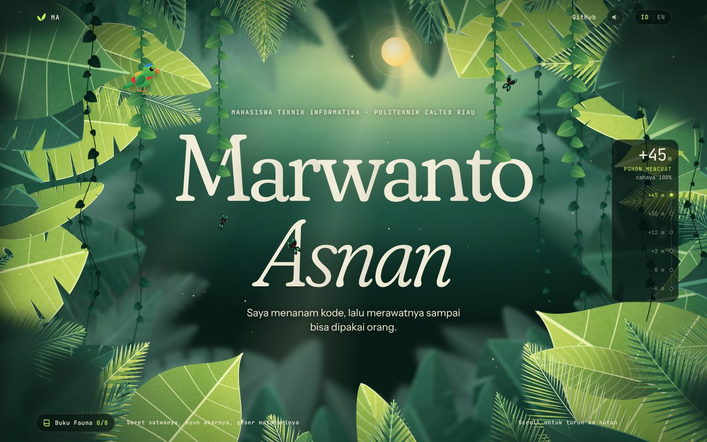
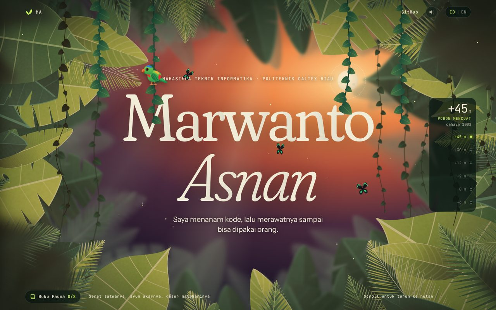
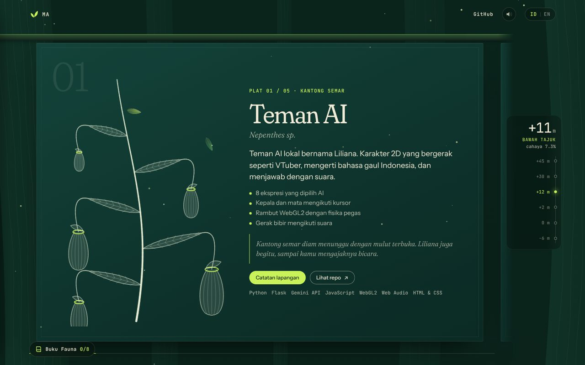
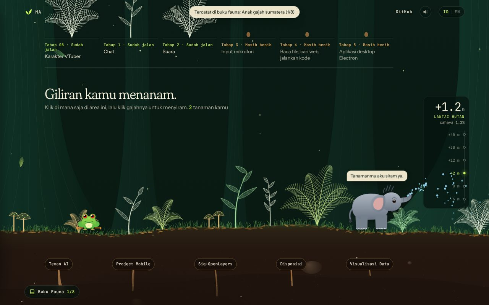
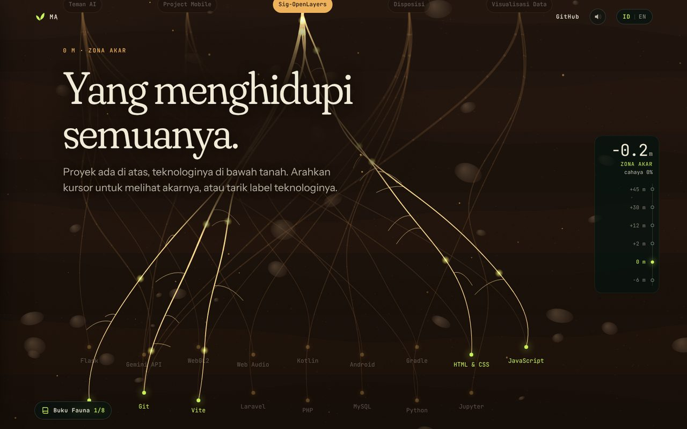

<div align="center">

# Rimba Vertikal

**Portofolio interaktif Marwanto Asnan**

Irisan hutan tropis Riau yang bisa disentuh. Scroll turun dari kanopi sampai gambut,
seret satwanya, ayun akarnya, dan geser mataharinya.




</div>

## Tentang

Rimba Vertikal adalah portofolio pribadi yang disusun seperti penampang hutan. Tiap section
adalah satu lapisan hutan, dan altimeter di samping layar menunjukkan ketinggian serta sisa cahaya.

| Ketinggian | Lapisan | Isi |
| --- | --- | --- |
| +45 m | Pohon Mencuat | Pembuka, nama, dan jam hutan |
| +30 m | Kanopi | Tentang saya |
| +12 m | Bawah Tajuk | Lima proyek sebagai lembar spesimen |
| +2 m | Lantai Hutan | Progres Teman AI dan lahan tanam |
| 0 m | Zona Akar | Tech stack sebagai jaringan akar |
| −6 m | Gambut | Kontak |

Semua tanaman dan satwa digambar oleh kode dengan Canvas dan SVG, jadi tidak ada file gambar
daun atau hewan. Hutannya juga sedikit berbeda setiap kali dibuka.

## Tampilan

| Senja | Spesimen proyek |
| --- | --- |
|  |  |

| Lantai hutan | Jaringan akar |
| --- | --- |
|  |  |

## Yang bisa dimainkan

### Satwa

Setiap satwa bisa diseret, dilempar, dan dibawa ke lapisan lain. Dekatkan dua satwa supaya mereka mengobrol.

| Satwa | Tempat | Cara bermain |
| --- | --- | --- |
| Serindit | Pohon Mencuat | Kabur saat didekati, tidur menggantung terbalik saat malam |
| Kupu-kupu raja | Pohon Mencuat | Menghindari kursor, coba tangkap |
| Siamang | Kanopi | Klik supaya berteriak, lempar ke akar supaya menangkapnya |
| Kukang | Bawah Tajuk | Lambat dan telat menjawab, tapi gesit saat malam |
| Anak gajah sumatera | Lantai Hutan | Klik supaya menyiram tanaman sampai mekar |
| Katak pohon | Lantai Hutan | Melompat, dan paling berisik saat malam |
| Trenggiling | Zona Akar | Menggulung jadi bola yang memantul di terowongan |
| Kunang-kunang | Gambut | Mengikuti kursor, buyar saat diklik |

### Dunia

- **Matahari:** geser untuk mengubah siang, senja, dan malam.
- **Akar gantung:** tarik dan ayun, atau biarkan siamang bergelantungan.
- **Huruf nama:** tarik, lalu lepas supaya memantul.
- **Label herbarium:** seret ke mana saja, klik dua kali untuk mengembalikannya.
- **Spesimen proyek:** seret tanamannya untuk memutar waktu.
- **Catatan lapangan:** buka detail tiap proyek.
- **Lahan tanam:** klik untuk menanam, lalu klik gajah untuk menyiram.
- **Label teknologi:** arahkan kursor untuk melihat akarnya, atau tarik supaya akarnya melar.
- **Buku Fauna:** temukan delapan satwa untuk memekarkan bunga langka di lapisan paling bawah.
- **Suara hutan:** suara satwa dibuat oleh Web Audio. Bawaannya mati, nyalakan dari bar atas.

## Teknologi

- **React 19** dan **TypeScript 5** (mode strict)
- **Vite 6** untuk server lokal dan build
- **Canvas 2D** untuk hutan, tanaman, akar, dan partikel
- **SVG** untuk satwa
- Fisika buatan sendiri untuk seret-lempar, pantulan, dan akar gantung (Verlet)
- **Web Audio API** untuk suara
- **Lenis** untuk scroll halus

## Menjalankan di komputer

Butuh [Node.js](https://nodejs.org) versi 18 atau lebih baru.

```bash
npm start
```

Saat pertama kali, paket terpasang otomatis, lalu browser terbuka di `http://localhost:5173`.

| Perintah | Fungsi |
| --- | --- |
| `npm start` | Jalankan lokal dan buka browser |
| `npm run dev` | Jalankan lokal tanpa membuka browser |
| `npm run typecheck` | Cek tipe TypeScript |
| `npm run build` | Buat versi siap online di folder `dist` |
| `npm run preview` | Coba hasil build |

## Mengganti isi

Semua isi ada di dua file, jadi kode lain tidak perlu disentuh.

| File | Isi |
| --- | --- |
| `src/data/portfolio.ts` | Nama, kontak di bagian `links`, proyek, tech stack, dan teks ID/EN |
| `src/data/fauna.ts` | Fakta satwa, ucapan, dan dialog antar satwa |

Link kontak yang kosong otomatis tidak tampil. Foto ada di `Asset/marwanto-cutout.webp`,
ganti dengan PNG atau WebP berlatar transparan.

## Struktur folder

```text
.
├── Asset/            foto dan font, dipakai langsung oleh Vite
├── docs/             gambar untuk README
├── scripts/          pemasangan otomatis saat npm start
├── src/
│   ├── components/   section halaman
│   ├── core/         ticker, scroll, bahasa, suara, status dunia
│   ├── data/         ISI WEBSITE
│   ├── fauna/        gambar, fisika, dan sifat satwa
│   └── flora/        mesin penggambar tanaman
├── index.html
└── vite.config.ts
```

## Keamanan sebelum push

`.gitignore` sudah memblokir file env, kunci, kredensial, database, arsip, dan foto asli.
Tetap ada tiga hal yang perlu diingat:

1. **Cek dulu sebelum commit.** Jalankan `git add .` lalu `git status`, dan baca daftar filenya.
2. **Jangan taruh rahasia di `src/`.** Semua kode di sana terkirim ke browser pengunjung,
   termasuk variabel `VITE_*`. Website ini juga tidak butuh API key.
3. **`.gitignore` tidak berlaku surut.** Kalau file rahasia terlanjur di-commit, ganti dulu
   kuncinya, lalu keluarkan file itu dari git:

```bash
git rm --cached nama-file
git commit -m "Hapus file sensitif"
```

Perintah di atas hanya menghapus file dari commit terbaru. File itu masih ada di riwayat git,
jadi kunci yang pernah ter-push harus dianggap bocor.

## Online lewat GitHub Pages

Repo berisi kode sumber ini tidak bisa langsung dijadikan website, karena browser hanya bisa
membaca hasil build. Pakai repo terpisah untuk hasilnya:

1. Jalankan `npm run build`.
2. Buat repo publik bernama `MarwCode.github.io`.
3. Upload **isi folder `dist`** ke repo itu.
4. Buka **Settings → Pages**, pilih branch `main` dan folder `/ (root)`.

Website akan muncul di `https://marwcode.github.io`.

## Aksesibilitas dan performa

- Satwa, matahari, dan label teknologi bisa dipakai lewat keyboard.
- Pengguna dengan pengaturan *reduce motion* mendapat versi yang lebih tenang.
- Tampilan menyesuaikan layar HP.
- Kualitas animasi otomatis turun di komputer yang berat, tanpa mengubah isi halaman.

## Kredit

- Fakta satwa: [Blue-crowned hanging parrot](https://en.wikipedia.org/wiki/Blue-crowned_hanging_parrot)
  dan [Taman Nasional Tesso Nilo](https://www.indonesia.travel/de/en/destinations/sumatra/pelalawan/tesso-nilo-national-park)
- Inspirasi interaksi: [template-porto-pantai](https://github.com/ryhndastra/template-porto-pantai)
- [Lenis](https://github.com/darkroomengineering/lenis), React, dan Vite (MIT), TypeScript (Apache-2.0)
- Font Fraunces, Instrument Sans, dan JetBrains Mono (SIL Open Font License 1.1)

---

© 2026 Marwanto Asnan
